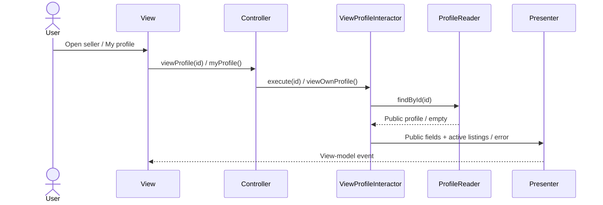

# Tony: public profiles (UC3 and UC4)

## Run and test

Requires JDK 11 or newer, with `java` and `javac` on PATH. No dependencies or credentials are needed.
From the repository directory in PowerShell:

```powershell
./profile.ps1 test
./profile.ps1 run
```

The Swing demo starts with Tony's profile. Choose **Edit profile**, change the name,
bio, campus or picture, then **Save** or **Cancel**. Enter `seller` in the seller-ID
box to view a different account, its rating and active listings. Enter an unknown ID
to exercise the unavailable-account message. The ID field is a demo navigation
control; the final item-page controller can call `viewProfile(sellerId)` directly.

Pictures are local PNG/JPG/GIF files, selected through a file chooser (up to 5 MB).
The preview preserves aspect ratio; missing files show a placeholder. Remove picture
clears it on save. Images are not uploaded or shared between computers in this demo.
Profile edits last for the current process only.

## Architecture and SOLID

All new production files are under `src/profile`, with packages matching folders.

```text
Swing ProfilePanel -> ProfileController -> input boundaries -> interactors
                                                   |              |
                                  output boundary <-+              -> entities
                                         ^                         -> storage/session interfaces
                                  ProfilePresenter                        ^
                                         |                         in-memory adapter
                                  ProfileViewModel
                                         |
                                    Swing listener
```

- Entities hold immutable public data and editable-field invariants. They have no
  Swing, storage or use-case dependencies. Public projections contain no email,
  password, bookmarks or other private account fields.
- UC3 retrieves a profile and filters its listing summaries to active listings.
- UC4 handles prefill, authorization, validation, save and cancellation. It validates
  the target against a trusted session on every operation, including save. The
  repository atomically replaces editable fields only; rating/listings/identity
  cannot be overwritten by form data. Cancellation performs no write.
- The controller translates UI actions to requests. The presenter updates observable
  state. The view owns drafts; error events do not refill and erase unsaved input.
- Single responsibility: persistence, orchestration, validation and rendering are
  separate. Interface segregation: view requires only `ProfileReader`; editing
  uses `ProfileReader` and `ProfileWriter`. Dependency inversion: interactors depend
  on ports rather than concrete storage or Swing. Open/closed: new persistence and
  session adapters can be wired without changing the use cases. Substitutability:
  adapters must follow the documented missing-account/update/error contracts.
- `ProfileApp` is the composition root and the only place choosing concrete adapters.

Validation: trimmed display name 1–80 characters, bio at most 1000 characters,
picture reference at most 2048 characters, and one of St. George, Scarborough or
Mississauga. Empty bio/picture are supported. These length limits are explicit
implementation choices; the README specifies nonempty names but no numeric limits.

## Team integration and current limitations

The current main branch contains empty login, application and data-access files.
Its default-package `src/Entities/User.java` references missing `Review` and
`PasswordHasher` classes. Accordingly, `profile.ps1` deliberately compiles the
complete profile module and its tests, rather than claiming the whole repository
builds. It does not change other teammates' unfinished authentication/entity code.

`PublicProfile` is a public projection, not a second authentication account. To
connect the team backend:

1. Implement `ProfileReader` and `ProfileWriter` over the canonical account and
   listing store. Map the account ID, display name, picture, bio, campus, average
   rating, and listing summaries to `PublicProfile`. Account creation should supply
   initial profile details. Updates must change only editable fields, atomically,
   and return empty for deleted accounts. Translate persistence failures into
   `ProfileStorageException`; enforce the same ownership policy in the backend.
2. Implement `CurrentUser` using the login session. Return null when logged out;
   never use the form's target ID as authentication. The fixed `tony` session in
   `ProfileApp` is demo data only.
3. Wire these adapters into the existing interactors in the application's composition
   root. Mount `ProfilePanel` in the team's navigation and use
   `ProfileController.viewProfile(sellerId)` from item pages.
4. For remote storage, execute use cases off the Swing event thread and dispatch
   presenter updates onto it. The current in-memory adapter is synchronous.
5. For shared profile pictures, replace the local picker/reference renderer with
   the team's image storage/upload adapter. No Supabase/Imgur calls are claimed here.

Tests cover successful view/edit, active listing filtering, missing accounts, all
validation limits, immutable snapshots, ownership, logged-out access, session
changes, storage failures, deletion during save, and Swing save/cancel/error flows.

## Sequence diagrams



```mermaid
sequenceDiagram
    actor User
    participant View
    participant EditProfileInteractor
    participant CurrentUser
    participant Store
    participant Presenter
    User->>View: Edit
    View->>EditProfileInteractor: begin(id), through controller
    EditProfileInteractor->>CurrentUser: userId()
    EditProfileInteractor->>Store: Read current profile if authorized
    EditProfileInteractor->>Presenter: Prefill form
    User->>View: Change fields
    alt Save
        View->>EditProfileInteractor: save(request), through controller
        EditProfileInteractor->>CurrentUser: Recheck userId()
        EditProfileInteractor->>EditProfileInteractor: Validate editable details
        EditProfileInteractor->>Store: Atomic update of existing profile
        EditProfileInteractor->>Presenter: Updated profile / error preserving draft
    else Cancel
        View->>EditProfileInteractor: cancel(id), through controller
        EditProfileInteractor->>Store: Read persisted profile; no write
        EditProfileInteractor->>Presenter: Display persisted profile
    end
```
